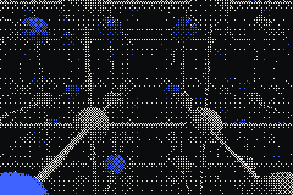
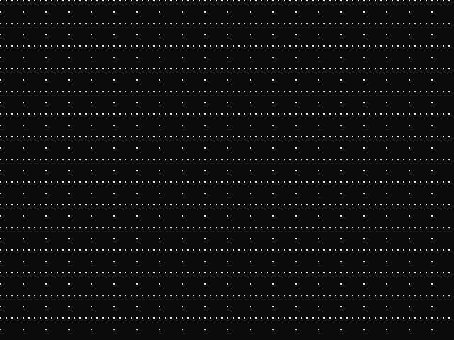

<p align="center"></p>

# Lattice

**Team-wide skills that build on each other.** Lattice turns the methods your team approves into shared skills for coding agents. Each skill can pin the approved skills beneath it at exact versions, so every agent on the team starts from everyone's best work.

Works with Codex, Claude Code, Cursor, and any client that speaks remote MCP (Streamable HTTP). MIT licensed.

**Live:** https://lattice-team-ai.vercel.app · **Demo (no account):** https://lattice-team-ai.vercel.app/demo

<p align="center"></p>

## How it works

1. **Capture.** After good work, your agent asks if that was the ideal method. Say yes and it writes the method up as a private draft. Nothing is shared until the author approves it.
2. **Compose and pin.** A skill can reference other approved skills as children at exact versions ("Ship a release" pins "Run release checks" at v4). Approval freezes a version; updating a child never silently changes a parent.
3. **Borrow.** Teammates' agents search summaries first, inspect one node, then load only the methods they need. Every load records the version used.

See [SKILL-ARCHITECTURE.md](SKILL-ARCHITECTURE.md) for the full skill contract, progressive loading, and permission semantics.

## Included

- Personal skill drafts, editing, author approval, private/team sharing, borrowing, and SKILL.md export.
- Composable skills: purpose, expected result, inputs, checks, capability needs, and pinned child references (up to 12 direct children). Cycles are rejected.
- Teams with owner/member roles, one-use invite links, optional email restriction, expiry, revocation, and member removal. Invitations are links to share; Lattice does not send invitation emails.
- Remote Streamable HTTP MCP: OAuth authorization codes with PKCE, rotating refresh tokens, and revocable personal access tokens.
- MCP Apps approval card with save/share buttons, plus an authenticated review-page fallback for clients that don't render it.
- `/install`: a copyable prompt that connects the current agent and adds Lattice guidance to `AGENTS.md`, `CLAUDE.md`, or a Cursor rule.
- Optional Codex hooks that suggest capturing a method after edits, without reading source files or transcripts.
- A browser-only demo at `/demo` with sample data, isolated from real accounts.

The agent writes a method from its task context. Lattice does not run a background model or record sessions. Inline approval-card rendering is up to each agent host.

## Quick start

Requires Node.js 20+.

```bash
git clone https://github.com/VedSoni-dev/lattice
cd lattice
npm ci
npm run build
npm test
npm run dev   # http://localhost:4174 — landing page and /demo work without a database
```

## Self-hosting

Lattice deploys to Vercel with Postgres and email-code sign-in on [Neon](https://neon.com) (Neon Auth).

1. Copy `.env.example` to `.env.local` and set `DATABASE_URL`, `NEON_AUTH_BASE_URL`, `APP_ORIGIN`, and a random server-only `OAUTH_CLIENT_SECRET`. Set `EMAIL_AUTH_READY=true` to switch the landing page's calls to action to sign-up.
2. Apply the schema once: `node scripts/migrate-neon.mjs`, then `node scripts/migrate-skill-trees.mjs`. The first refuses to overwrite an existing schema.
3. Optionally run `NEON_AUTH_ENDPOINT_ID=... node scripts/configure-neon.mjs` to add your origin to Neon Auth's trusted origins.
4. `vercel --prod`.

Account cookies are HTTPS-only, so test real sign-in against an HTTPS origin. Neon's shared email sender is rate-limited and meant for development; set up a dedicated sender before a broad launch ([Neon's checklist](https://neon.com/docs/auth/production-checklist)).

Security model: workspace identity always comes from a live provider session inside the same transaction as the action. No API accepts a caller-chosen identity or arbitrary SQL. Private tables are not directly accessible; bounded functions enforce author and team permissions. Never expose database URLs, session tokens, or server secrets to the browser.

To point the Codex setup kit at your deployment: `LATTICE_URL=https://your-host node codex-setup/install.mjs`.

## Tests

`npm test` runs the automated suite against an in-process Postgres (PGlite): team/invite/skill authorization, version pinning and reference cycles, MCP composition and nonce privacy, OAuth/PKCE replay and rotation, hook privacy, cookie attributes, CSRF, and install-prompt routing.

`tests/live-neon-smoke.mjs` and `tests/live-mcp-smoke.mjs` run against a real deployment and are invoked by hand. They create and remove only their own generated fixtures.

## Landing page media

The landing page dithers its scenes live in WebGL (an 8×8 Bayer matrix, three inks). The GIFs and video in `media/` are rendered from code with no external assets:

```bash
node scripts/make-media.mjs   # needs ffmpeg
```

## License

[MIT](LICENSE)
